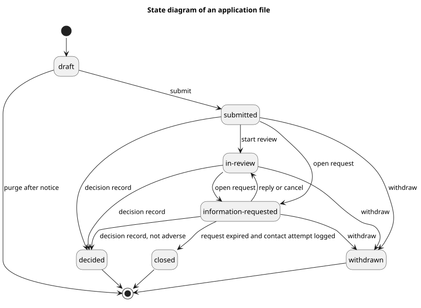

= Lifecycle
include::_fpsot-terms.adoc[]

Démarche Numérique, the French platform for public procedures, gives each file six states.
It sends a file back to the applicant with a message when something is missing.
GovStack Registration has four statuses for each role, and no state for a withdrawal.
This page sets one lifecycle that holds every channel, and keeps the decision out of it.

A file starts as a `draft`, and becomes `submitted` when the applicant submits it.
Staff move it to `in-review`, and a request for information moves it to `information-requested` until the applicant replies.
Only a decision record moves it to `decided`.
Before that, the applicant can withdraw it.
The body can close it after an expired request and a logged contact attempt.

== States

[[APP-030]]
*APP-030.* Each application MUST be a record of the class `ApplicationFile` of `model/applications.yaml`.
Its `state` MUST be one of these seven values.

[cols="1,3",options="header"]
|===
|State |Meaning
|`draft` |The applicant is still answering, and the body has received nothing.
|`submitted` |The body received the application, and nobody has started to review it.
|`in-review` |Staff or a service are reviewing the application.
|`information-requested` |A request for information is open, under APP-051.
|`decided` |A decision record of the decisions specification gives the result.
|`withdrawn` |The applicant withdrew the application before a decision.
|`closed` |The body closed the file for no response, under APP-057.
|===

`decided`, `withdrawn` and `closed` are final.
A file in a final state never takes another state.

For paper and other assisted channels, the body receives the application before the draft exists.
The history then records when staff keyed it in.
The receipt record holds when the body received it, under APP-041 and APP-092.

[[APP-031]]
*APP-031.* A file MUST move only along the moves of this table.
Each move MUST add an entry to `stateHistory`.
The entry holds the new state, the instant, the acting party under APP-071 and a reason code.

[cols="1,3",options="header"]
|===
|From |To
|`draft` |`submitted`, and a draft that the service purges under APP-034 leaves no file
|`submitted` |`in-review`, `information-requested`, `decided`, `withdrawn`
|`in-review` |`information-requested`, `decided`, `withdrawn`
|`information-requested` |`in-review`, `decided` with no adverse outcome, under APP-052, `withdrawn`, `closed`
|===

The history keeps the age of the file, whatever system holds it later.
A file that moved from a digital system to paper then keeps its true age.

[[APP-032]]
*APP-032.* Only a decision record under DEC-040 MAY move a file to `decided`.
The entry MUST name that record, and copy its result kind and its outcome, under DEC-024.
A `referred` result MUST NOT move a file to `decided`, since a person still has to decide, under DEC-061.
A move to `decided` is adverse, unless it has the result kind `decided` and an outcome of `fullGrantOutcomes`.
A review, an appeal or a reconsideration after a decision MUST follow the review steps of DEC-062 and DEC-063.
It MUST NOT reopen or edit the file.

A later case specification may hold the case that such a review opens.
The intake copies the result, and never chooses it, under APP-101.
A refusal, a partial grant, `insufficient-information` and `not-applicable` are therefore adverse to the applicant.
So is each outcome that the program does not list as a full grant.
The reasons stay in the decision record, and the status that the applicant sees shows no outcome, under APP-082.

== Drafts

[[APP-033]]
*APP-033.* A service MUST keep each draft on its own side by default.
A service MAY keep drafts on the device of the applicant instead.
Its declaration then says so, and the front end tells the applicant.
Each draft MUST record the `url|version` of its form.
A draft MUST survive the end of a session: answers saved before a session expires MUST stay.
Each time limit of a session MUST meet ACC-001, with criterion 2.2.1 of WCAG 2.2.

A security session and a draft are two things.
A person who signs in again then finds their answers.

[[APP-034]]
*APP-034.* Each service declaration MUST state how long a draft lasts without activity.
The service MUST tell the applicant that period when it saves a draft.
It MUST send a notice before it purges a draft, when it has a way to reach the applicant.
The profile sets how long before.
The purge of a draft MUST be a logged event of the class `DraftEvent`.

A person MUST resume a draft by signing in, or by a link that works once and expires.
Resuming MUST NOT rest on security questions alone, under ACC-024.

Security questions test memory.
A link sent by email alone can reach a person who shares an inbox with an abuser.
Signing in or a single-use link avoids both, and password managers then work.

[[APP-035]]
*APP-035.* A draft MUST stay on the form version on which it started.
A service MAY move a draft to a newer `active` version only by an explicit step.
It logs that step as a `DraftEvent` of kind `migrated`.
That step MUST carry each answer to an unchanged question by its `id`, and drop no answer silently.
The front end MUST show the applicant each new and each changed question before the check of answers.

GOV.UK Forms keeps a draft on its starting version, and Démarche Numérique moves drafts to each new revision.
This rule keeps the first by default, and allows the second only as a visible step.

== Submission

[[APP-036]]
*APP-036.* Before submission, the front end MUST show every answer and every attachment, with a way to change each one.
The applicant MUST then confirm, in a step that says that the application is not yet sent.
The service MUST check the answers against the `schema` of the form version of the draft.
It MUST refuse the submission while an attachment is not `clean`, under APP-063.
On success, it MUST create the first `FileVersion` and the receipt record of APP-040.
It MUST also keep a byte-exact copy of the form version used, sealed with the receipt record under APP-042.

The check of answers meets criterion 3.3.4 of WCAG 2.2.
The sealed copy shows the form that the applicant answered, even after the form changes.

[[APP-037]]
*APP-037.* Each `FileVersion` MUST NOT change after its submission.
A reply to a request for information MUST add a new `FileVersion` that names the previous one in `previousVersionId`.
A new version MUST NOT overwrite an answer or an attachment that an earlier one holds.
The service MUST judge each version against the form version that it records.

The body can then show what the applicant sent on each date.
A changed form, or a reply, never rewrites a submission.

[[APP-038]]
*APP-038.* An applicant MAY withdraw a submitted application in any state that is not final.
A representative MAY withdraw it when the scope of the representation covers that act, under APP-070.
The withdrawal MUST be a move to `withdrawn` under APP-031, and MUST NOT delete the file or its versions.

The profile and the records schedule decide how long the body keeps a withdrawn file.
Whether the body may still decide after a withdrawal is a question for counsel.

== Document history

[cols="1,1,4",options="header"]
|===
|Version |Date |Change
|0.1.0 |2026-11-26 |First version.
|===
