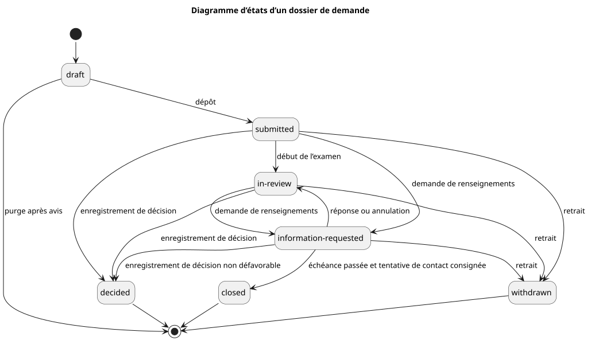

= Cycle de vie
include::_fpsot-terms.adoc[]

Démarche Numérique, la plateforme française des démarches publiques, donne six états à chaque dossier.
Elle renvoie un dossier à la personne avec un message quand il manque quelque chose.
GovStack Registration a quatre statuts par rôle, et aucun état pour un retrait.
Cette page fixe un seul cycle de vie pour tous les canaux, et en tient la décision à l’écart.

Un dossier commence à l’état `draft`, et passe à `submitted` quand la personne le dépose.
Le personnel le fait passer à `in-review`.
Une demande de renseignements le fait passer à `information-requested` jusqu’à la réponse de la personne.
Seul un enregistrement de décision le fait passer à `decided`.
Avant cela, la personne peut le retirer.
L’organisme peut le fermer après une échéance passée et une tentative de contact consignée.

== États

[[APP-030]]
*APP-030.* Chaque demande DOIT être une donnée de la classe `ApplicationFile` de `model/applications.yaml`.
Son `state` DOIT prendre une de ces sept valeurs.

[cols="1,3",options="header"]
|===
|État |Sens
|`draft` |La personne répond encore, et l’organisme n’a rien reçu.
|`submitted` |L’organisme a reçu la demande, et personne n’a commencé à l’examiner.
|`in-review` |Le personnel ou un service examine la demande.
|`information-requested` |Une demande de renseignements est ouverte, selon APP-051.
|`decided` |Un enregistrement de décision de la spécification sur les décisions donne le résultat.
|`withdrawn` |La personne a retiré sa demande avant la décision.
|`closed` |L’organisme a fermé le dossier faute de réponse, selon APP-057.
|===

`decided`, `withdrawn` et `closed` sont définitifs.
Un dossier dans un état définitif ne prend plus jamais d’autre état.

Pour le papier et les autres canaux assistés, l’organisme reçoit la demande avant que le brouillon existe.
L’historique consigne alors le moment de la saisie par le personnel.
Le constat de réception contient le moment où l’organisme a reçu la demande, selon APP-041 et APP-092.

[[APP-031]]
*APP-031.* Un dossier NE DOIT passer d’un état à l’autre que selon les passages de ce tableau.
Chaque passage DOIT ajouter une entrée à `stateHistory`.
L’entrée contient le nouvel état, l’instant, la partie agissante selon APP-071 et un code de motif.

[cols="1,3",options="header"]
|===
|De |Vers
|`draft` |`submitted` ; un brouillon que le service purge selon APP-034 ne laisse aucun dossier
|`submitted` |`in-review`, `information-requested`, `decided`, `withdrawn`
|`in-review` |`information-requested`, `decided`, `withdrawn`
|`information-requested` |`in-review`, `decided` sans résultat défavorable selon APP-052, `withdrawn`, `closed`
|===

L’historique garde l’âge du dossier, quel que soit le système qui le détient plus tard.
Un dossier passé d’un système numérique au papier garde alors son âge réel.

[[APP-032]]
*APP-032.* Seul un enregistrement de décision selon DEC-040 PEUT faire passer un dossier à `decided`.
L’entrée DOIT nommer cet enregistrement, et en reprendre le type de résultat et l’issue, selon DEC-024.
Un résultat `referred` NE DOIT PAS faire passer un dossier à `decided`, puisqu’une personne doit encore décider, selon DEC-061.
Un passage à `decided` est défavorable, sauf avec le type de résultat `decided` et une issue de `fullGrantOutcomes`.
Une révision, un appel ou un réexamen après la décision DOIT suivre les étapes de révision de DEC-062 et DEC-063.
Il NE DOIT PAS rouvrir ni modifier le dossier.

Une future spécification sur le traitement des affaires pourra contenir l’affaire qu’ouvre une telle révision.
Le service d’accueil reprend le résultat, et ne le choisit jamais, selon APP-101.
Un refus, un octroi partiel, `insufficient-information` et `not-applicable` sont donc défavorables à la personne requérante.
Il en est de même de chaque issue que le programme ne désigne pas comme un octroi complet.
Les motifs restent dans l’enregistrement de décision, et l’état que voit la personne ne montre aucune issue, selon APP-082.

== Brouillons

[[APP-033]]
*APP-033.* Un service DOIT garder chaque brouillon chez lui par défaut.
Un service PEUT plutôt garder les brouillons sur l’appareil de la personne.
Sa déclaration le dit alors, et l’interface utilisateur en informe la personne.
Chaque brouillon DOIT consigner le `url|version` de son formulaire.
Un brouillon DOIT survivre à la fin d’une session : les réponses enregistrées avant l’expiration DOIVENT rester.
Chaque délai d’une session DOIT respecter ACC-001, avec le critère 2.2.1 des WCAG 2.2.

Une session de sécurité et un brouillon sont deux choses distinctes.
Une personne qui se reconnecte retrouve alors ses réponses.

[[APP-034]]
*APP-034.* Chaque déclaration de service DOIT indiquer combien de temps dure un brouillon sans activité.
Le service DOIT indiquer cette durée à la personne quand il enregistre un brouillon.
Il DOIT envoyer un avis avant de purger un brouillon, quand il a un moyen de joindre la personne.
Le profil fixe combien de temps avant.
La purge d’un brouillon DOIT être un événement consigné de la classe `DraftEvent`.

Une personne DOIT reprendre un brouillon en se connectant, ou par un lien à usage unique qui expire.
La reprise NE DOIT PAS reposer sur des questions de sécurité seulement, selon ACC-024.

Les questions de sécurité font appel à la mémoire.
Un lien envoyé par courriel seulement peut atteindre une personne qui partage sa boîte avec un agresseur.
La connexion ou le lien à usage unique évite les deux, et les gestionnaires de mots de passe fonctionnent alors.

[[APP-035]]
*APP-035.* Un brouillon DOIT rester sur la version de formulaire sur laquelle il a commencé.
Un service PEUT faire passer un brouillon à une version `active` plus récente par une étape explicite seulement.
Il consigne cette étape comme un `DraftEvent` du genre `migrated`.
Cette étape DOIT reporter chaque réponse à une question inchangée selon son `id`, et n’effacer aucune réponse en silence.
L’interface DOIT montrer à la personne requérante chaque question nouvelle ou modifiée avant la vérification des réponses.

GOV.UK Forms garde un brouillon sur sa version de départ.
Démarche Numérique déplace les brouillons vers chaque nouvelle révision.
Cette règle retient la première approche par défaut, et ne permet la seconde que comme une étape visible.

== Dépôt

[[APP-036]]
*APP-036.* Avant le dépôt, l’interface DOIT montrer chaque réponse et chaque pièce jointe, avec un moyen de modifier chacune.
La personne DOIT ensuite confirmer, à une étape qui dit que la demande n’est pas encore transmise.
Le service DOIT vérifier les réponses selon le `schema` de la version de formulaire du brouillon.
Il DOIT refuser le dépôt tant qu’une pièce jointe n’est pas `clean`, selon APP-063.
En cas de succès, il DOIT créer la première `FileVersion` et le constat de réception d’APP-040.
Il DOIT aussi garder une copie exacte de la version de formulaire employée, cachetée avec le constat selon APP-042.

La vérification des réponses respecte le critère 3.3.4 des WCAG 2.2.
La copie cachetée montre le formulaire auquel la personne a répondu, même après une modification du formulaire.

[[APP-037]]
*APP-037.* Chaque `FileVersion` NE DOIT PAS changer après son dépôt.
Une réponse à une demande de renseignements DOIT ajouter une nouvelle `FileVersion` qui nomme la précédente dans `previousVersionId`.
Une nouvelle version NE DOIT PAS écraser une réponse ou une pièce jointe que contient une version antérieure.
Le service DOIT juger chaque version selon la version de formulaire qu’elle consigne.

L’organisme peut alors montrer ce que la personne a transmis à chaque date.
Un formulaire modifié, ou une réponse, ne réécrit jamais un dépôt.

[[APP-038]]
*APP-038.* La personne requérante PEUT retirer sa demande déposée dans tout état qui n’est pas définitif.
Une personne qui la représente PEUT la retirer quand la portée de la représentation couvre cet acte, selon APP-070.
Le retrait DOIT être un passage à `withdrawn` selon APP-031, et NE DOIT PAS supprimer le dossier ni ses versions.

Le profil et le calendrier de conservation fixent combien de temps l’organisme garde un dossier retiré.
La question de savoir si l’organisme peut encore décider après un retrait relève des conseillers juridiques.

== Historique du document

[cols="1,1,4",options="header"]
|===
|Version |Date |Changement
|0.1.0 |2026-11-26 |Première version.
|===
